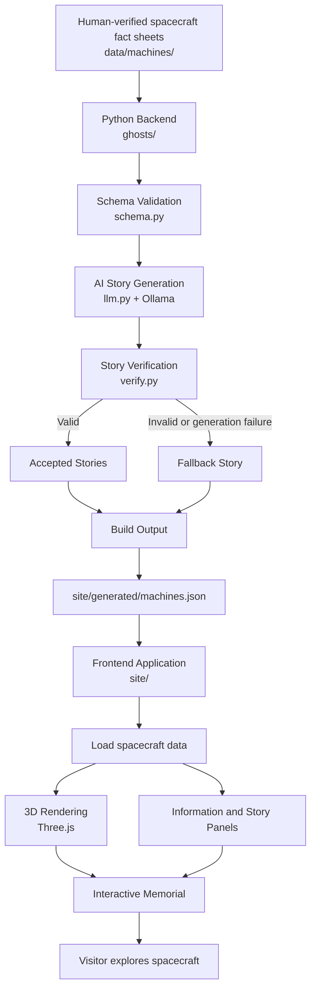

# Ofrenda of the Machines

### Stories for the spacecraft we left behind.

Ofrenda of the Machines is an interactive, AI-powered digital memorial dedicated to robotic spacecraft that have explored our Solar System and beyond.

Some machines have completed their missions and now rest on distant worlds. Others continue travelling through interstellar space. Some were lost before they could fulfil their missions.

This project gives each of them a place to be remembered.

Through an interactive 3D experience, visitors can explore spacecraft, discover their missions and scientific contributions, and read their stories in two age-appropriate formats.

The project combines **human-verified scientific information, locally generated AI storytelling, and an interactive 3D frontend** to create an educational experience that is both informative and reflective.

---

## Table of Contents

- [Project Overview](#project-overview)
- [Core Features](#core-features)
- [System Architecture](#system-architecture)
- [How the System Works](#how-the-system-works)
- [Project Structure](#project-structure)
- [Technology Stack](#technology-stack)
- [Adding a New Spacecraft](#adding-a-new-spacecraft)
- [Installation and Setup](#installation-and-setup)
- [Running the Project](#running-the-project)
- [Testing](#testing)
- [Data Integrity and Safety](#data-integrity-and-safety)
- [Future Improvements](#future-improvements)
- [Disclaimer](#disclaimer)

---

## Project Overview

Ofrenda of the Machines is built around three categories of spacecraft:

| Category | Meaning | Example |
|---|---|---|
| Resting | Spacecraft that completed their mission and are no longer operational | Opportunity |
| Restless | Spacecraft that continue travelling or operating | Voyager 1 |
| Lost | Spacecraft whose missions ended unexpectedly or whose fate remains unknown | Mars Polar Lander |

Each spacecraft is represented by a 3D model placed within a virtual memorial environment.

Visitors can select a spacecraft to explore:

- Its mission and purpose.
- Important discoveries.
- How the spacecraft operated.
- Its launch and mission timeline.
- Verified information sources.
- Two AI-generated stories: a younger-reader version and an older-reader version.

The system is designed to be offline-first, using a locally hosted language model rather than relying on external AI APIs.

## Core Features

### 1. Verified scientific information

Each spacecraft has a structured fact sheet containing mission information, discoveries, operational details, and references.

The fact sheets act as the source of truth for story generation.

### 2. AI-generated storytelling

A locally hosted Gemma model generates two versions of each spacecraft's story:

- **Younger version:** Simple vocabulary and shorter sentences.
- **Older version:** More detailed storytelling with scientific context.

### 3. Story verification and fallback

Generated stories are checked against the spacecraft's verified information.

If a story fails verification or generation is unsuccessful, the system can use a fallback story instead.

### 4. Interactive 3D memorial

The frontend uses Three.js to display spacecraft in a virtual altar environment.

Visitors can select spacecraft, explore their information, switch between story levels, and change the presentation between Altar and List views.

### 5. Offline-first architecture

The AI generation pipeline runs locally through Ollama. The website uses locally stored assets and dependencies rather than requiring an external CDN for its runtime.

---

## System Architecture

The project follows a four-stage architecture:

**Verified Data → Python Backend → Generated JSON → Interactive Website**

### Architecture Diagram



### Architecture Components

| Component | Responsibility |
|---|---|
| Fact sheets | Store verified spacecraft information |
| Python backend | Validate data and coordinate story generation |
| Ollama + Gemma | Generate age-appropriate stories locally |
| Verification layer | Check generated stories against verified facts |
| Build pipeline | Assemble the final JSON output |
| Frontend | Display spacecraft, stories, facts, and sources |
| Three.js | Render and manage the interactive 3D environment |

---

## How the System Works

The project is divided into two major workflows: the **content-generation pipeline** and the **website runtime**.

### A. Content-generation pipeline

**Step 1 — Prepare spacecraft data**

A spacecraft is represented by a JSON fact sheet containing its identity, mission information, discoveries, operational details, and sources.

**Step 2 — Validate the fact sheet**

The Python backend checks that the input follows the expected schema and contains the required information.

**Step 3 — Generate stories**

The backend sends the verified information to the local Gemma model through Ollama.

The model generates two stories using the same verified information but different reading levels.

**Step 4 — Verify generated stories**

The verification layer checks the generated content for factual consistency.

If generation or verification fails, a fallback mechanism provides a safe alternative.

**Step 5 — Build the output**

The pipeline combines the spacecraft information, sources, metadata, and stories into:

`site/generated/machines.json`

This file becomes the data source for the website.

### B. Website runtime

**Step 1 — Load generated data**

The frontend reads `site/generated/machines.json`.

**Step 2 — Configure spacecraft models**

The machine configuration maps spacecraft IDs to their respective 3D model kinds.

**Step 3 — Render the memorial**

Three.js creates the 3D environment and displays the spacecraft.

**Step 4 — Enable interaction**

Visitors can select spacecraft, open their information panels, switch between story levels, and explore the available information.

**Important:** AI story generation happens during the build process, not every time a visitor opens the website. This keeps the website independent of a live LLM request.

---

## Project Structure

The repository is organized into three primary areas: the Python backend, the frontend, and the spacecraft data.

```text
hacktober/
│
├── data/
│   └── machines/
│       ├── opportunity.json
│       ├── voyager-1.json
│       ├── mars-polar-lander.json
│       └── ...
│
├── ghosts/
│   ├── __init__.py
│   ├── build.py
│   ├── schema.py
│   ├── llm.py
│   ├── verify.py
│   └── voice.py
│
├── site/
│   ├── index.html
│   ├── style.css
│   ├── app.js
│   ├── altar.js
│   ├── model.js
│   ├── models3d.js
│   ├── viewer.js
│   ├── machine-config.json
│   │
│   ├── generated/
│   │   └── machines.json
│   │
│   ├── vendor/
│   │   ├── three.module.js
│   │   ├── three.core.js
│   │   └── OrbitControls.js
│   │
│   └── tests/
│       └── e2e/
│           └── browser-check.mjs
│
├── tests/
│   ├── test_build.py
│   ├── test_llm.py
│   ├── test_schema.py
│   └── ...
│
├── pyproject.toml
├── README.md
└── .gitignore
```

### Backend — `ghosts/`

| File | Responsibility |
|---|---|
| `build.py` | Main orchestration script. Coordinates validation, story generation, verification, fallback handling, and JSON output. |
| `schema.py` | Defines and validates the expected spacecraft data structure. |
| `llm.py` | Handles communication with the locally hosted language model through Ollama and story generation. |
| `verify.py` | Checks generated stories for consistency with verified spacecraft facts. |
| `voice.py` | Contains the project's voice-related functionality. |

### Data — `data/machines/`

Each JSON file represents one spacecraft.

For example:

- `opportunity.json`
- `voyager-1.json`
- `mars-polar-lander.json`

These files contain the verified information used by the backend.

### Frontend — `site/`

| File | Responsibility |
|---|---|
| `index.html` | Main HTML entry point of the website. |
| `style.css` | Defines the visual appearance, layout, responsive design, and memorial environment. |
| `app.js` | Coordinates the main frontend application and its interactions. |
| `altar.js` | Handles the memorial altar experience and spacecraft presentation. |
| `model.js` | Handles spacecraft model-related functionality. |
| `models3d.js` | Contains 3D model creation and rendering support. |
| `viewer.js` | Supports the 3D viewing and interaction experience. |
| `machine-config.json` | Maps spacecraft IDs to their 3D model kinds. |
| `generated/machines.json` | Generated output consumed by the frontend. |

### Local Dependencies — `site/vendor/`

| File | Responsibility |
|---|---|
| `three.module.js` | Local Three.js module entry point. |
| `three.core.js` | Three.js core implementation. |
| `OrbitControls.js` | Camera orbit and navigation controls. |

These dependencies are stored locally to avoid relying on an external CDN at runtime.

### Tests — `tests/` and `site/tests/`

- `tests/` contains Python backend tests.
- `site/tests/` contains frontend tests.
- `site/tests/e2e/` contains browser-based end-to-end checks.

### Root Configuration Files

| File | Responsibility |
|---|---|
| `pyproject.toml` | Python project configuration and dependencies. |
| `README.md` | Project documentation and setup instructions. |
| `.gitignore` | Excludes virtual environments, caches, generated temporary files, and other local development artifacts from Git. |
| `site/package.json` | Frontend package configuration and test scripts. |
| `site/package-lock.json` | Locks the frontend dependency versions. |

---

## Technology Stack

| Layer | Technologies |
|---|---|
| Backend | Python |
| Data validation | Pydantic |
| AI model | Gemma 4 (`gemma4:e4b`) |
| Local model runtime | Ollama |
| Frontend | HTML, CSS, JavaScript |
| 3D rendering | Three.js |
| Camera interaction | OrbitControls |
| Backend testing | Pytest |
| Frontend testing | Node.js test runner |
| Browser testing | Puppeteer with local Chrome |

### Why a local language model?

Using Ollama allows the project to generate stories without depending on an external AI API.

It also makes the content-generation pipeline reproducible in a local development environment.

---

## Adding a New Spacecraft

The project is designed to support additional spacecraft without requiring changes to the core pipeline for every new entry.

Follow these steps.

### Step 1 — Create a new fact sheet

Create a JSON file inside:

`data/machines/`

For example:

`data/machines/cassini.json`

Use an existing spacecraft fact sheet as a reference for the expected structure.

The fact sheet should contain:

- Unique spacecraft ID.
- Spacecraft name.
- Agency.
- Memorial category (`resting`, `restless`, or `lost`).
- Mission body or destination.
- Launch, arrival, and end dates where applicable.
- Current or final mission status.
- Mission purpose.
- Scientific discoveries.
- How the spacecraft worked.
- Relevant facts.
- Reliable source references.
- Verification status.

Dates or other fields that are genuinely unknown should use the schema's supported null representation rather than invented values.

### Step 2 — Add reliable sources

Use trustworthy references, preferably primary mission sources such as NASA, JPL, ESA, or other responsible space agencies.

Every important factual claim should be traceable to a source.

### Step 3 — Verify the fact sheet

Set the verification field to `true` only after the information has been reviewed.

The fact sheet must satisfy the project's schema before it can be included in the generated output.

### Step 4 — Configure its 3D model kind

Open:

`site/machine-config.json`

Add an entry using the spacecraft's exact ID.

For example:

```json
{
  "opportunity": {
    "kind": "rover"
  },
  "voyager-1": {
    "kind": "probe"
  },
  "mars-polar-lander": {
    "kind": "lander"
  },
  "cassini": {
    "kind": "probe"
  }
}
```

Use an existing supported model kind when appropriate. The frontend also provides a generic 3D fallback for unknown machine kinds.

### Step 5 — Run the build pipeline

From the project root:

```powershell
python -m ghosts.build --model gemma4:e4b
```

The pipeline will:

1. Read the spacecraft fact sheet.
2. Validate its structure.
3. Generate the younger and older stories.
4. Verify the generated stories.
5. Use fallback content if required.
6. Update `site/generated/machines.json`.

### Step 6 — Verify the website

Open the website and check that:

- The new spacecraft appears.
- Its category is correct.
- Its 3D representation is appropriate.
- Its information panel displays correctly.
- Both story levels work.
- Its sources open correctly.

**Adding a spacecraft should primarily involve adding a fact sheet and configuring its model kind.** The existing pipeline handles the remaining data-processing steps.

---

## Installation and Setup

### Prerequisites

Install the following before running the project:

- Python 3.12 or a compatible version.
- Node.js and npm.
- Ollama.
- Git.
- A locally installed Chrome browser for browser-based testing.

### 1. Clone the repository

```powershell
git clone <REPOSITORY_URL>
cd hacktober
```

### 2. Set up Python

Create a virtual environment:

```powershell
python -m venv .venv
```

Activate it on Windows:

```powershell
.venv\Scripts\Activate.ps1
```

Install the project dependencies:

```powershell
pip install -e .
```

If you use a development dependency group, install it according to the configuration in `pyproject.toml`.

### 3. Set up Ollama

Install Ollama and pull the model:

```powershell
ollama pull gemma4:e4b
```

Confirm that the model is available:

```powershell
ollama list
```

Ensure the Ollama service is running before using the generation pipeline.

### 4. Set up frontend dependencies

```powershell
cd site
npm install
```

Return to the project root when running Python backend commands:

```powershell
cd ..
```

---

## Running the Project

### Build the spacecraft stories

From the project root:

```powershell
python -m ghosts.build --model gemma4:e4b
```

This generates or updates:

`site/generated/machines.json`

### Run the website

For local development, use a local static HTTP server.

From the project root:

```powershell
python -m http.server 8000 --directory site
```

Open:

`http://localhost:8000`

### Run frontend tests

From the `site/` directory:

```powershell
npm test
```

### Run backend tests

From the project root:

```powershell
python -m pytest -v
```

---

## Testing

Testing is divided into backend, frontend, and browser-level checks.

### Backend tests

The Python test suite covers the build pipeline, schema validation, LLM client, story verification, fallback handling, and related backend behavior.

### Frontend tests

The Node.js test suite checks frontend functionality and application behavior.

### Browser tests

The browser-based tests use Puppeteer and a locally installed Chrome browser to check the website's real interactions, rendering, and responsive behavior.

The test suites should be run independently so that failures can be traced to the relevant layer.

---

## Data Integrity and Safety

The project follows several important principles:

1. **Verified facts come first.** AI-generated stories are based on structured, human-reviewed spacecraft data.
2. **AI is not the source of truth.** The language model is responsible for storytelling, not independently establishing scientific facts.
3. **Verification before publication.** Generated stories pass through a verification step before being included in the website output.
4. **Fallback behavior.** If generation or verification fails, the system can use fallback content.
5. **No invented mission data.** Unknown dates and mission details should remain unknown.
6. **Local execution.** The model is hosted locally through Ollama.
7. **Safe frontend rendering.** Dynamic content should be inserted using safe DOM APIs such as `textContent`, rather than interpreting untrusted data as HTML.
8. **Trusted external links.** External source links should use HTTPS and safe link attributes.
9. **Verified status.** A spacecraft should only receive a verified indicator when its verification field is explicitly `true`.

---

## Future Improvements

Potential directions for expanding the project include:

- Adding more spacecraft from different space agencies.
- Supporting more detailed spacecraft models.
- Improving the story verification system.
- Adding more languages and reading levels.
- Introducing audio narration.
- Adding a timeline of important mission events.
- Expanding the memorial with additional exploration categories.
- Improving accessibility and low-performance-device support.

---

## Disclaimer

Ofrenda of the Machines is an independent educational and memorial project.

It is not affiliated with, endorsed by, or officially associated with NASA, JPL, ESA, or any other space agency.

All mission information should be interpreted alongside the cited original sources.

---

## The Idea Behind the Project

Spacecraft are built to explore places humans cannot easily reach.

Some send data for decades. Some travel farther than anyone imagined. Some fall silent before their missions are complete.

Even when communication ends, their contributions remain.

**Ofrenda of the Machines is a place to remember the machines that helped us understand our universe.**